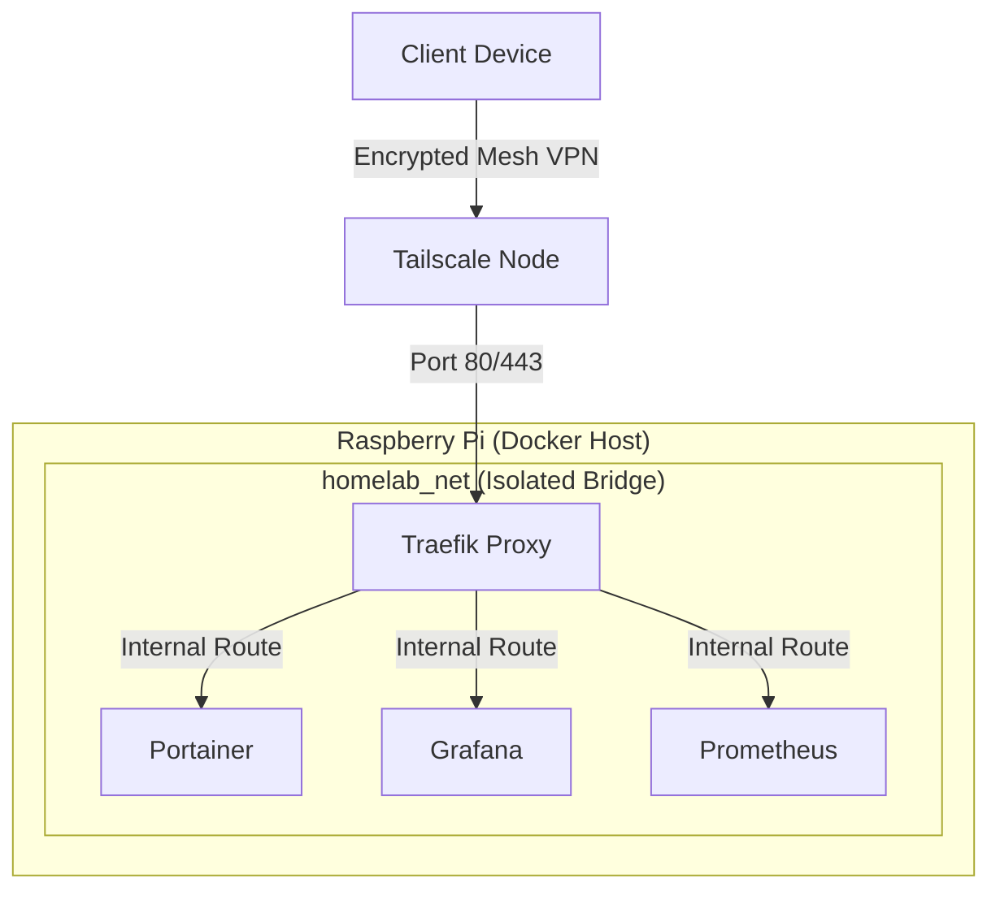

# Raspberry Pi Homelab Infrastructure

A declarative, Infrastructure as Code (IaC) homelab deployed on a Raspberry Pi 4. This repository documents the architectural foundation for a secure, reverse-proxied, and monitored internal environment.

## Architecture & Design Decisions

This infrastructure is built with **DevSecOps** and **Zero-Trust** principles at its core. As a private homelab, the focus is on robust internal routing, strict access control, and isolation rather than public exposure.

### 1. Zero-Trust Network Access
* **No Port Forwarding:** The local router has no open ports to the public internet. The infrastructure is entirely invisible to external port scanners and automated attacks.
* **Mesh VPN:** Access to the infrastructure is strictly gated through a **Tailscale** mesh network. Only authenticated clients within the Tailnet can resolve and reach the internal services.

### 2. Single Entrypoint (Reverse Proxy)
* **Traefik v3:** Acts as the sole ingress controller for the environment. Traefik listens on ports `80` and `443` and dynamically routes incoming HTTP(S) requests to the appropriate containers based on Docker labels.
* **Closed Host Ports:** Individual services (Grafana, Prometheus, Portainer) do not expose any ports to the host machine. They are completely inaccessible via `<IP>:<PORT>` bindings, forcing all traffic through the proxy.

### 3. Network Isolation
* **Dedicated Bridge Network:** All services share a dedicated, isolated Docker bridge network (`homelab_net`).
* **Internal Routing:** Traefik intercepts the request and injects it directly into the target container's internal port over the `homelab_net`, ensuring that backend traffic never touches the host's default network.

### 4. Least Privilege Execution
* **Control Plane (Portainer):** Container management is handled via Portainer, which is strictly isolated within the Tailnet. 
* **Protected Docker Socket:** Services that require access to the Docker daemon (like Traefik for service discovery) have the `/var/run/docker.sock` mounted as strictly read-only (`:ro`) to prevent privilege escalation.

## 🗺️ Internal Service Routing

All external access is blocked. The services below are dynamically discovered by Traefik and routed internally over the `homelab_net`.

| Service | Role | Internal Port | Ingress Route (Tailnet) |
| :--- | :--- | :--- | :--- |
| **Traefik** | Reverse Proxy / API | `8080` | `traefik.homelab.local` |
| **Portainer** | Container Management | `9000` | `portainer.homelab.local` |
| **Grafana** | Data Visualization | `3000` | `grafana.homelab.local` |
| **Prometheus**| Metrics & Scraping | `9090` | `prometheus.homelab.local` |

## 📊 Network Topology

## Infrastructure Stack

* **Hardware:** Raspberry Pi 4 Model B (ARM64)
* **Orchestration:** Docker & Docker Compose
* **Reverse Proxy:** Traefik
* **Monitoring:** Prometheus & Grafana (Routed internally)
* **Networking:** Tailscale